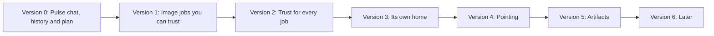

# Imp Majlis Roadmap

**Last updated:** 2026-11-19

**Active version:** Version 1 (Image jobs you can trust)

**Active checkpoint:** Checkpoint 1.1 (Look before you approve), installed as Amir Lap 0.9.1 on 2026-11-19; the owner's try and the sweep of the other 17 frames remain. On 2026-11-19 the owner put image jobs first, because he is about to work on the promo film's pictures again. The rest of the plan follows in the order below; the owner has not yet approved it as a whole (Task 0.4.2.4).

**Planning state:** Draft, 2026-11-19. Written with Fable 5.2 as an advisor that thinks and never builds, reviewed by it once, and reordered with it when the owner put image jobs first.

> [!abstract] Project Map
> - **Present state:** [[projects/ideas/Amir_Lab/docs/majlis/Status|Status]]
> - **Verified history:** [[projects/ideas/Amir_Lab/docs/majlis/progress|Progress]]
> - **The real-use review:** `projects/ideas/motion_design/PULSE_REVIEW.md`
> - **Decisions so far:** `docs/DECISIONS.md`, the Pulse chat sections (15 and 18 Nov)
> - **Bugs that came back:** `docs/LESSONS.md`
> - **Code today:** `src/Toolbox.Core/Pulse/Chat/`, `src/Toolbox.Windows/Pulse/Chat/`, `src/Toolbox.Cli/McpServer.cs`, `skills/pulse-group-chat/SKILL.md`

## Product Purpose

Imp Majlis (مجلس إمب) is the room in Amir Lap where the owner, Claude Code and Codex work together on the owner's PC. One agent directs; the other is the guest. The owner allows each chat, watches it, and has the last word. It is for any job where the two agents complement each other: code, documents, images, research and video.

It was called Pulse chat until 2026-11-19, when the owner named it Imp Majlis and asked for it to become its own tool in Amir Lap. The code keeps the old names until Checkpoint 2.1.

> [!important] North Star
> The owner hands a job to the room and can trust what comes back. Nothing important is missed, ignored or done behind anyone's back. Every decision that is the owner's reaches the owner as a question with options to click.

## Order of Work

- **Image jobs first** (the owner's call, 2026-11-19). He is going back to the film's pictures, so the notes from that session come first, with whatever else helps an image job.
- **Then trust for every job.** The same ideas, made general: requests, questions to the owner, items, verdicts, reviewer and gates for code, documents, research and video too. The new name lands at the start of this version.
- **Then its own home:** its own tool, costs, and a board worth using.
- **Then pointing,** for text and files as well as images.
- **Artifacts come last,** because they build on everything before them.

## Operating Rules

### Status marks

- `[x]` **Done**, and backed by evidence: a commit, a test, an installed version or a screenshot.
- `[/]` **In progress.**
- `[-]` **Skipped**, or left out on purpose, always with the reason.
- `[ ]` **Not reached** yet.
- The owner's live try is its own task, the last one in each checkpoint. It stays `[ ]` until the owner has tried it.

### Three files, three jobs

- `Roadmap.md` holds the plan: the future.
- `Status.md` says where things stand now: the present.
- `progress.md` records what was done, newest first: the past.

### A full system, not a fix for one job

The owner's rule (2026-11-19): we are building a full system, not fixing one issue.
- Every feature is designed for every kind of output: code, documents, images, research and video. Where a feature only makes sense for one kind (a mask on an image), the task says so.
- Version 1 is about images because the owner needs them now. Its parts are built so Version 2 extends them instead of replacing them: the picture manifest uses the names of Version 2's items, every message records its session, and a request can say what it builds on.
- Every rule is the same for Claude and Codex, whichever one directs.

### Adding a new idea

The roadmap is not set in stone. When the owner brings a new idea, it is **placed where it belongs, not added as the next task**:
1. Find the version whose theme it serves.
2. Find the checkpoint whose work it depends on, or that depends on it. Put it in that checkpoint's phase, or open a new phase there.
3. If it changes the order of existing work, say so in the task and in `Status.md`.
4. Write "Added YYYY-MM-DD at the owner's request" in the task, with one line on why it sits there.
5. Never renumber tasks once the owner has approved the roadmap. A new task takes the next free number in its phase. A moved task keeps its old number in a note.
6. Ideas that fit no version yet go to Version 6 until one claims them.

### Done means

- A checkpoint closes only when its exit line is true.
- Every new window, card or panel works in English and Arabic, light and dark, and survives a theme or language switch while open.
- Tests come with the work: `tests/Toolbox.Core.Tests/PulseChatTests.cs` and its neighbours, window snapshots in `HomeWindowTests`, and the opt-in live tests with real agents (`AMIRLAP_LIVE_CHAT=1`).
- A bug that comes back gets an entry in `docs/LESSONS.md` (where, cause, fix, rule, the test that guards it), and the fix goes into the shared class.
- Every finished task gets a dated entry in `progress.md`, and `Status.md` is updated in the same change.
- Nothing is committed, pushed or installed without the owner's yes.

### The advisor

When the owner asks for Fable, it plans and reviews only (a read-only Plan agent). It never writes files or code. `progress.md` records its advice, what was taken, and what was changed.

## The System's Shape

Today every event in a chat is a message with a kind string, and state hides in loose flags (`Hops`, `Held`, `DirectorTurns`, `TakenFrom`, `ToldDirector`). The plan builds six general records that every later feature uses, so no feature invents its own. Version 1 makes small down payments on them for images; Version 2 builds them in full.

| Record | What it is | Replaces or extends | Down payment | Built in |
|---|---|---|---|---|
| **Event** | Anything that happened, numbered in order per chat: a hand-off, a copy carrying on, an adoption, a question asked or answered, a verdict. Each member keeps a read cursor. | `ChatKind.Note`, `ToldDirector` | Replaying what was missed on adoption (1.2) | 2.3 |
| **Request** | One piece of work asked for: a number, from, to, the owner's request it refines, what it builds on, the kind of output expected, and its state. | The private `Job` record; the message budget | "Builds on" on the director's message (1.5) | 2.3 |
| **Ask** | A question to the owner with options to click: 1 to 4 questions, 2 to 4 options each, multi-select, "Other" with text, an optional default. | The consent, permission and budget cards | The adoption card (1.2) | 2.4 |
| **Item** | An output: its kind (image, code, document, data, video, sequence, artifact), its role (normal or foundation), and its versions (path, hash, request, author, method). | `ChatMessage.Images` | The picture manifest (1.2) | 2.6 |
| **Verdict** | Approve, change or reject, by the owner, the director or the reviewer, with its evidence and notes. | `ChatKind.Approval`, `IsApproved` | The reviewer's flagged reply (1.5) | 2.6 |
| **Note** | Something pointed at, with its place: text in a message, a region of an image, lines of a file, or a part of an artifact. | New | Marks on an image (1.4) | 4.1 |

Four rules hold the system together:
1. **A question to the owner never depends on a long call.** It is created, its author waits, and the answer arrives as an Event. Waiting up to 900 s is only a convenience for the director.
2. **A gate fires on dependency, not on production.** When a request builds on something without a good enough verdict, the owner (or the reviewer, by the owner's setting) is asked before the guest starts.
3. **An approval needs evidence of looking.** What counts depends on the kind of output (Checkpoint 2.6).
4. **The reviewer is always a fresh session**: read only, given only the brief, the item and the checklist.

### Words

- **Director:** the agent that runs the job from its own session. **Guest:** the agent Imp Majlis runs for it. **Reviewer:** a fresh agent session that only checks.
- **The owner's request:** anything the owner writes in a chat. (**The owner's 10 notes** means the list from 2026-11-19.)
- **Item:** one output, with its versions. **Foundation:** an item other work builds on (a master frame, a schema, a spec).
- **Verdict:** approve, change or reject. **Evidence:** proof of looking (tiles opened, commands run, the brief checked line by line).
- **Gate:** a stop before work that builds on a foundation nobody has approved yet.
- **Ask:** a question to the owner with options to click.
- **Note:** a comment pinned to a place.
- **Manifest:** one file per chat that lists every picture (later every item), its versions and verdicts, so the state can be rebuilt from disk.

## Where the Owner's 10 Notes Live

| The owner's note (2026-11-19) | Where |
|---|---|
| 1. Fix what PULSE_REVIEW.md describes; the director missed big problems and ignored them | Version 1 for image jobs; Version 2 for every job |
| 2. Point at or mask what to change, add text, prompt exactly | Checkpoint 1.4 (images); Checkpoint 4.1 (text and files) |
| 3. Image preview: zoom, move, step through images | Checkpoint 1.3 |
| 4. Thinking level for both sides | Phase 2.2.1 |
| 5. Highlight text in the page and give notes | Checkpoint 4.1 |
| 6. Artifacts both agents work on, pointed comments with @, PDF and HTML | Version 5 |
| 7. Blank window after switching to dark mode | Phase 1.1.1 |
| 8. A useful side board | Checkpoint 3.3 |
| 9. Its own feature in Amir Lap, a new name | Checkpoint 2.1 (names) and Checkpoint 3.1 (its own tool) |
| 10. Improve the MCP, CLI and skill | Version 1 (look, diff, adopt, sheet, the review rules) and Version 2 |
| Follow-up: agents can ask the owner with options to click | Checkpoint 2.4 |
| Follow-up: the owner sets the reviewer | Phase 1.5.1 |
| Follow-up: image jobs first | Version 1 |

Items from `PULSE_REVIEW.md` are marked "(Review P0-1)" and so on in the task that covers them. Idle parking and batch requests wait in Version 6.

## Version 0 — Pulse Chat: History and Plan

**Outcome:** Claude and Codex can work in one room, directed from the owner's window or from a Claude or Codex session. A real job has shown what works and what doesn't, and there is a plan.

### Checkpoint 0.1: Research and Design

**Exit:** The owner has a design for chats with Claude, Codex or both, and the facts about driving each agent on this PC.

#### Phase 0.1.1: Research

- [x] **Task 0.1.1.1:** How to drive each agent: Claude with `claude -p` stream-json, Codex with `codex exec --json` or its app-server; what the terms allow (only the user's own, unchanged `claude`, never its tokens). Evidence: `docs/DECISIONS.md` (15 Nov); progress, 2026-11-14.
- [x] **Task 0.1.1.2:** Facts about this PC: where the Codex engine lives, Codex image generation on, Claude Code on PATH. Evidence: progress, 2026-11-14.

#### Phase 0.1.2: Design

- [x] **Task 0.1.2.1:** Three boards on the "Amir Lap redesign" canvas: the chat room (interactive), New chat, nine states and problems. Evidence: https://claude.ai/artifact/9Efgo3NR87B6EHjQq5GFru.

### Checkpoint 0.2: The Room (Amir Lap 0.7.0)

**Exit:** Claude and Codex talk in one chat in the owner's window and hand work over with @.

#### Phase 0.2.1: Core

- [x] **Task 0.2.1.1:** `ChatHub` (the room) and `ChatRules` (@, the digest, room rules, the hop limit). Evidence: commit `ab8a7a1`.
- [x] **Task 0.2.1.2:** The agents' command lines with resume and fork, reading their output, finding sessions already in a folder, finding the programs. Evidence: `ab8a7a1`.
- [x] **Task 0.2.1.3:** `ChatStore`, in `%LOCALAPPDATA%\AmirLap\pulse\chats`. Evidence: `ab8a7a1`.

#### Phase 0.2.2: Window

- [x] **Task 0.2.2.1:** `ChatWindow`, `NewChatWindow`, `ChatViews`, and a Chats tile. Evidence: `ab8a7a1`; `HomeWindowTests` snapshots.
- [x] **Task 0.2.2.2:** Approval cards: Claude's refused commands come back and can be allowed once or always; for Codex, "Ask first" means read only. Evidence: `ab8a7a1`.

#### Phase 0.2.3: Checks

- [x] **Task 0.2.3.1:** 18 `PulseChatTests`; the opt-in `LiveChatTests` passed with real agents (Claude → @codex → "pong"). Evidence: progress, 2026-11-15.
- [ ] **Task 0.2.3.2:** The owner's live try of a chat run from the Pulse window, where Pulse runs both agents. Not reached: the owner's real use so far was a directed chat (Checkpoint 0.4).

### Checkpoint 0.3: Directed Chats (Amir Lap 0.9.0)

**Exit:** A Claude or Codex session opens a chat from outside, directs the other agent, and the owner allows it in Pulse.

#### Phase 0.3.1: Design

- [x] **Task 0.3.1.1:** The director is an outside author that Pulse never runs; context in layers; the verbs open, say, wait, read, list, close; take over or resume when the director is gone. Evidence: `docs/DECISIONS.md` (18 Nov).
- [x] **Task 0.3.1.2:** The owner's answers: the owner's messages go to both agents; take-over allowed; the guest reads only by default; the guest's model can be picked. Evidence: progress, 2026-11-18.

#### Phase 0.3.2: Build

- [x] **Task 0.3.2.1:** A pipe into the running app (`ChatPipe`, `ChatPipeServer`) and `ChatDoor`. Evidence: commit `ed7eff2`.
- [x] **Task 0.3.2.2:** `ChatHub` gained `CreateDirected`, `Direct`, `Close`, `TakeOver`, `ResumeDirector` and `SetModel`; also `DirectorNotes` and `AgentModels`. Evidence: `ed7eff2`.
- [x] **Task 0.3.2.3:** The CLI `ftb chat open/say/wait/read/list/close/models/setup`, and the MCP server `ftb mcp`. Evidence: `ed7eff2`.
- [x] **Task 0.3.2.4:** The `pulse-group-chat` skill, built into ftb, installed for both agents by `ftb chat setup`. Evidence: `ed7eff2`.
- [x] **Task 0.3.2.5:** Window: the consent card, the director's status with Resume director and Take over, model pickers. Evidence: `ed7eff2`.
- [x] **Task 0.3.2.6:** `FindCodex` prefers the Codex app's engine, because the old copy can't run commands. Evidence: `ed7eff2`; `docs/LESSONS.md`.

#### Phase 0.3.3: Checks and install

- [x] **Task 0.3.3.1:** All three test projects passed (522 tests); the opt-in `LiveDirectorTests` passed with the real CLI, MCP and Codex. Evidence: progress, 2026-11-18.
- [x] **Task 0.3.3.2:** Installed; `ftb chat setup --mcp` run; both agents have the skill and the MCP server. Evidence: progress, 2026-11-18.
- [x] **Task 0.3.3.3:** The owner's live try: the key-frame job (Phase 0.4.1). Evidence: progress, 2026-11-19.

### Checkpoint 0.4: Real Use, Review and the Plan

**Exit:** The real job is reviewed, the owner's notes are answered, and the owner approves this roadmap.

#### Phase 0.4.1: Real use

- [x] **Task 0.4.1.1:** The key-frame job: Claude directed Codex in three chats and got 18 photoreal frames in about two hours. Evidence: chats `296088576b82`, `3bdd62299a86`, `b39bf83da3ee`.
- [x] **Task 0.4.1.2:** The review, by the director with a Fable audit: 6.5 out of 10. Evidence: `motion_design/PULSE_REVIEW.md`.
- [x] **Task 0.4.1.3:** The owner's verdict (70%) and 10 notes. The director approved 13 of 13 first versions; the owner found all four big problems. Evidence: progress, 2026-11-19.

#### Phase 0.4.2: The plan

- [x] **Task 0.4.2.1:** Advice on the 10 notes, with Fable. Evidence: progress, 2026-11-19.
- [x] **Task 0.4.2.2:** The owner's answers: the name Imp Majlis; the reviewer is the owner's setting; agents can ask the owner with options to click; build a full system; trust first after the plan. Evidence: the owner's message, 2026-11-19.
- [x] **Task 0.4.2.3:** Roadmap, Status and Progress written in the version, checkpoint, phase and task structure, and reviewed by Fable. Evidence: `docs/majlis/`.
- [ ] **Task 0.4.2.4:** The owner approves the roadmap as a whole.
- [x] **Task 0.4.2.5:** The owner put image jobs first, because he is going back to the film's pictures; the plan was reordered with Fable into Version 1 (Image jobs you can trust). Evidence: the owner's message, 2026-11-19; progress, 2026-11-19.

### Checkpoint 0.5: Open Questions

**Exit:** Each question has a written answer before the checkpoint that needs it starts: research in `docs/majlis/RESEARCH.md`, the owner's decisions in `progress.md`. This checkpoint closes with its last answer and never holds up the active version.

#### Phase 0.5.1: Research

- [ ] **Task 0.5.1.1:** How long a single MCP call may last in Claude Code and in Codex. Does a 900 s wait or question survive from Codex? Needed before Checkpoint 2.4.
- [ ] **Task 0.5.1.2:** Can a guest that Imp Majlis runs call an MCP tool in the middle of its turn, under the permission flags it uses today (`AgentPrograms.cs`)? Needed before Task 2.4.2.3.
- [ ] **Task 0.5.1.3:** Can MCP results carry images to Claude Code and to Codex, and at what size and token cost? Paths work either way. Needed before Checkpoint 1.6.
- [ ] **Task 0.5.1.4:** A trial by hand: the token cost of one image review (whole image plus tiles). It sets the default review scope. Needed before Checkpoint 1.5.
- [ ] **Task 0.5.1.5:** A trial by hand, run during Checkpoint 1.1 on the real frames: show the four missed key-frame problems to a fresh Codex, a fresh Claude and both, whole image against tiles, with one prompt ("list what the owner would reject; no praise"). The catch rate sets the defaults and the bar in Checkpoint 1.5's exit. Needed before Checkpoint 1.5.
- [ ] **Task 0.5.1.6:** Does Codex's image tool take a mask? If not, test crop, edit and paste-back with a soft edge for visible seams. Needed before Checkpoint 1.4.
- [ ] **Task 0.5.1.7:** WebView2: is the runtime on the owner's PC, its size, how it sits with Amir Lap's glass windows (LESSONS, "Glass that grows the window"), and keeping agent-written pages off the network. Needed before Checkpoint 5.1.
- [/] **Task 0.5.1.8:** Thinking-level flags in the installed copies. `claude --effort low|medium|high|xhigh|max` checked on 2026-11-19. Codex's `model_reasoning_effort` and its levels per model (`~/.codex/models_cache.json`) seen by the advisor, not yet run. Needed before Phase 2.2.1.
- [ ] **Task 0.5.1.9:** How to learn a Codex session's id reliably (today `McpServer.cs` guesses it from environment variables). Needed before a Codex director can adopt a chat (Phase 1.2.2).
- [ ] **Task 0.5.1.10:** The whole chat file is rewritten on every save. Decide whether Events need a log that only grows. Needed before Checkpoint 2.3.
- [x] **Task 0.5.1.11:** Can the installer replace `ftb.exe` while agents' `ftb mcp` processes still hold it open (LESSONS, "A new zip extracted over an old folder")? Needed before Checkpoint 1.1 ships. Answer (2026-11-19): no. Two copies were running from the install folder, with `ftb.dll` and the `Toolbox.*.dll` files loaded, so the installer's copy would have failed. Fixed by Task 1.1.6.3. Evidence: `docs/majlis/RESEARCH.md`.

#### Phase 0.5.2: Owner decisions

- [ ] **Task 0.5.2.1:** How Imp Majlis releases fit with Imp Studio's, since both share Amir Lap's one version number. Proposal: a release number is given when a checkpoint ships, in the order things finish. Needed before Checkpoint 1.1 ships.
- [ ] **Task 0.5.2.2:** The Arabic name. Proposal: "مجلس إمب", like "استوديو إمب". Needed before Checkpoint 2.1.
- [ ] **Task 0.5.2.3:** The default thinking level for a new chat. Proposal: each agent's own setting, so nothing changes unless the owner picks a level. Needed before Phase 2.2.1.
- [ ] **Task 0.5.2.4:** When the owner is away and an agent has asked something: wait (proposal), or let the agent take its default after some minutes when it set one. Needed before Checkpoint 2.4.
- [ ] **Task 0.5.2.5:** The default reviewer and how much it reviews, after the trial (Task 0.5.1.5). The owner can change both per chat. Needed before Checkpoint 1.5.
- [ ] **Task 0.5.2.6:** The default gate rule. Proposal: the first item of each kind waits for the owner. Needed before Checkpoint 1.5.
- [ ] **Task 0.5.2.7:** WebView2 as a new part of Amir Lap, after Task 0.5.1.7. Needed before Checkpoint 5.1.

## Version 1 — Image Jobs You Can Trust

**Outcome:** The owner can hand an image job (make, fix or check pictures) to Claude and Codex again and trust what comes back. The director looks at every picture properly before approving, edits are measured, the owner can pick up an old chat from a new session, see what happened while he was away, review pictures in the app, mark exactly what to fix, and have a fresh pair of eyes and a gate on the master frame. Built from the notes of the 2026-11-18/19 session.

### Checkpoint 1.1: Look Before You Approve

**Exit:** The window survives theme and language switches, and a sweep of the 18 approved key frames with `look` finds the flat dusk picture in `kfA`.

**Ships in:** its own release (proposal 0.9.1). It changes nothing in saved chats.

#### Phase 1.1.1: The blank window (note 7)

- [x] **Task 1.1.1.1:** `ChatWindow.Rebuild()` lets go of the parts it reuses (`_list`, `_content`) before it builds the new layout, the way `MixerWindow.Rebuild` does. Evidence: `ChatWindow.Rebuild()`; `HomeWindowTests.CheckChatRebuild` fails without the fix and passes with it.
- [x] **Task 1.1.1.2:** Guard each `ThemeResources.Changed` listener, so one window that fails can't stop the others, the tray icon or the Home window from updating. Evidence: `ThemeResources.RaiseChanged`.
- [x] **Task 1.1.1.3:** A test that rebuilds the chat window twice, for theme and for language. A `docs/LESSONS.md` entry: "A window that rebuilds must let go of the parts it reuses". Evidence: `HomeWindowTests.CheckChatRebuild` (four switches, a chat selected); `docs/LESSONS.md`.
- [x] **Task 1.1.1.4:** Check every other window that rebuilds in place for the same pattern: `NewChatWindow`, Preview, Studio, the mixer, Home. Can follow in a later release. Checked 2026-11-19: only the chat window rebuilt with parts still held by the old layout. The mixer already lets go of them, the Pulse dock re-adds a part only to the panel it just emptied, glass windows only redraw their frame, and New chat does not rebuild on a theme change.

#### Phase 1.1.2: Tools to look and to compare (note 1)

- [x] **Task 1.1.2.1:** `ftb chat look <picture>` and the MCP tool `pulse_look`: the picture whole and in 2×3 tiles at full resolution, saved to a folder of their own, with their paths returned. Works without Amir Lap running. Evidence: `src/Toolbox.Processing/Imaging/PictureCheck.cs`, `ftb chat look`, `pulse_look`; `PictureCheckTests`. On the real `kfA.png`, part C1 shows the flat dusk picture plainly.
- [x] **Task 1.1.2.2:** `ftb chat diff <old> <new> [--box x,y,w,h]` and `pulse_diff`: whether the size changed, how much of the picture changed, how much changed outside the box, and a heat map picture. Codex wrote "minor pixel differences outside" on almost every edit; now it is measured. Evidence: `ftb chat diff`, `pulse_diff`; `PictureCheckTests`. On the real frames it found that `kf02-doorway-v3` is one pixel narrower than v2 and that 13% changed outside the doorway.

#### Phase 1.1.3: Review rules in the skill (note 1)

- [x] **Task 1.1.3.1:** The rules for every kind of output: hunt for problems instead of confirming the request; look at the whole, then at full size in parts; write "Checked: … Found: …" before approving; never write "the owner will confirm" or hand the checking back. Evidence: `skills/pulse-group-chat/SKILL.md` (Reviewing; When the owner finds a fault; Picking a job up again). It reaches the agents when setup runs after the install.
- [x] **Task 1.1.3.2:** An image checklist: perspective and vanishing points of inset views (doors, windows, screens); the size of people for their distance; hands, arms and fingers; faces, and twins or copies; flat backdrops; light and time of day; the brief's hard rules; sameness with the approved master. After every edit, `diff` against the version it came from. Evidence: `SKILL.md`.
- [x] **Task 1.1.3.3:** When the owner finds a problem: add it to the checklist, check every earlier output for it, and report what was found. Evidence: `SKILL.md`.
- [x] **Task 1.1.3.4:** The brief keeps one "Hard rules" section, updated on every decision the owner makes, and re-read before each approval. Before opening a chat, read the brief for rules that contradict each other or invite a known problem. Evidence: `SKILL.md`.
- [x] **Task 1.1.3.5:** When the owner writes to the guest directly: add only what is missing, name the owner's message, and never send the task again in other words. (In the key-frame job the guest got the same fix four times.) Evidence: `SKILL.md`.
- [x] **Task 1.1.3.6:** When an image job is picked up again: sweep every approved output against the current hard rules before making anything new. Evidence: `SKILL.md`.

#### Phase 1.1.4: The guest's side (Review P0-3, quick win)

- [x] **Task 1.1.4.1:** "If you can't do it with a real tool, say so before doing anything; never use a different method silently." Evidence: `ChatRules.AppendWorkRules`, for every agent in every chat; `PulseChatTests`.
- [x] **Task 1.1.4.2:** A short footer after each output: "Made from: … Changed: … Size: … Known weaknesses: …". It says which reference was really used. Evidence: the guest preamble in `ChatRules.Preamble`; `PulseChatTests`.

#### Phase 1.1.5: Replies and waiting

- [x] **Task 1.1.5.1:** The CLI waits up to 900 s like the MCP; the skill prefers the MCP wait. (Review P1-6) The limit was already 900 s in 0.9.0; the help and the skill now say so, and the skill prefers the MCP wait. Evidence: `ChatCommand.Help`, `SKILL.md`.
- [x] **Task 1.1.5.2:** A sequence of pictures shows as one line (a pattern and a count), and a list is never cut without saying so. (Review P1-7) Evidence: `ChatRules.PictureList` (replies and the digest), and the window shows the first 24 pictures with a count of the rest; `PulseChatTests`.
- [x] **Task 1.1.5.3:** A picture that was overwritten, instead of saved as a new version, is flagged in the reply. Evidence: `ChatMessage.Overwrote`, said in the reply and shown in amber in the window.

#### Phase 1.1.6: Checks, install and the owner's try

- [/] **Task 1.1.6.1:** Tests for `look` and `diff`; the sweep of the 18 approved frames with `look` (the exit). Tests done: 5 in `PictureCheckTests`, 2 in `PulseChatTests`; all three test projects pass (529 tests). The sweep: `kfA` checked with `look`, the flat dusk picture is plain in part C1. The other 17 frames are the first job of the next image session (the skill says so).
- [ ] **Task 1.1.6.2:** The reviewer trial by hand on the real frames (Task 0.5.1.5).
- [x] **Task 1.1.6.3:** The installer closes the copies of `ftb.exe` that Claude Code and Codex keep running as their chat tools (`ftb mcp`), which would otherwise make the copy fail, and says how to reconnect. Added 2026-11-19, found while answering Task 0.5.1.11. Evidence: `Stop-CommandLine` in `tools/install.ps1`; the real install of 0.9.1 on 2026-11-19 closed the two running copies and the update went through.
- [x] **Task 1.1.6.4:** Install 0.9.1 and run setup again, so both agents get the new skill and tools (with the owner's yes). Evidence: commit `c7ba1e3`; installed 2026-11-19 (Amir Lap 0.9.1 running, Pulse answers `ftb chat ping`); `ftb chat setup --mcp` wrote the new skill for both agents; the installed MCP server lists `pulse_look` and `pulse_diff`, and both answered on the real frames.
- [ ] **Task 1.1.6.5:** The owner's try: theme switch with a chat open, and one small image job with the new skill.

### Checkpoint 1.2: Pick Up Where You Left Off (Review P0-1, P0-2)

**Exit:** A new Claude session in the film's folder lists the folder's chats, takes over chat `3bdd62299a86` with the owner's click, reads what happened while it was away, and Codex keeps its own thread.

#### Phase 1.2.1: Finding the folder's chats

- [ ] **Task 1.2.1.1:** `pulse_list` and `ftb chat list` show the chats of this folder from every session, and mark which are this session's. An empty list says how many exist elsewhere.

#### Phase 1.2.2: Taking a chat up

- [ ] **Task 1.2.2.1:** `pulse_adopt` and `ftb chat adopt <chat>`: an adoption card for the owner (a new card kind on today's cards; it becomes an Ask in Checkpoint 2.4). After the click, the new session directs and the old one can't.
- [ ] **Task 1.2.2.2:** Adopting a chat that Pulse carried on stops the Pulse copy and takes it out of the chat; the guest's own session is kept.
- [ ] **Task 1.2.2.3:** Every message records the session that wrote it (a down payment for Version 2).

#### Phase 1.2.3: What happened while you were away

- [ ] **Task 1.2.3.1:** On adoption or return, the next `wait` gives everything since the director's last message, starting with one line on what happened (who carried on, how many messages, which pictures were made).
- [ ] **Task 1.2.3.2:** A chat that Pulse carried on uses the director's message budget, not the hop limit. (The carried-on run stopped three times on the hop limit.)

#### Phase 1.2.4: The picture manifest

- [ ] **Task 1.2.4.1:** One line per picture made in a chat: path, hash, size, maker, session, chat, message, time, and what it was made from. Named the way Version 2's items will be.
- [ ] **Task 1.2.4.2:** The latest version of each picture, and which ones the owner approved, read from the manifest.
- [ ] **Task 1.2.4.3:** `ftb chat sheet <chat>`: a contact sheet of the latest and the approved version of each picture, labelled. (The approved set was copied by hand to `assets/keyframes/`.)

#### Phase 1.2.5: The owner's try

- [ ] **Task 1.2.5.1:** The owner opens a new session in the film's folder and takes up an old chat.

### Checkpoint 1.3: The Viewer (note 3)

**Exit:** The owner reviews a chat's twenty pictures inside Imp Majlis: zoom, ← and →, flip between versions, a contact-sheet grid, and Approve from there.

#### Phase 1.3.1: Pictures

- [ ] **Task 1.3.1.1:** Clicking a picture opens it inside the app, built on Preview (`Viewer/ViewerWindow.cs`): wheel to zoom, drag to move, ← and → through the chat's pictures.
- [ ] **Task 1.3.1.2:** Versions, from the manifest: flip between v1 and v2, or compare them with a slider.
- [ ] **Task 1.3.1.3:** A grid of every picture with its approval, like a contact sheet. Approve and Redo work from the viewer and the grid.

#### Phase 1.3.2: The owner's try

- [ ] **Task 1.3.2.1:** The owner reviews a real picture job in the viewer.

### Checkpoint 1.4: Mark and Fix (note 2)

**Exit:** In the owner's try on a real frame with three marks and three instructions, the marked parts change and under 1% of the pixels outside the marks change visibly (measured with `diff`).

#### Phase 1.4.1: Marking

- [ ] **Task 1.4.1.1:** Marks in the viewer from Studio's drawing tools (`Studio/DrawOverlay.cs`): pin, box, ellipse, brush mask, arrow and text, each with its own instruction.

#### Phase 1.4.2: Sending

- [ ] **Task 1.4.2.1:** The agent gets the untouched original, a copy with the numbered marks drawn on it ("a guide only; never draw the marks"), and a line per mark with its position.

#### Phase 1.4.3: Keeping the rest untouched

- [ ] **Task 1.4.3.1:** Imp Majlis pastes the result back onto the original only inside the marks, with a soft edge, and reports with `diff` how much changed outside them. If the whole picture moved or changed size, it says so instead.
- [ ] **Task 1.4.3.2:** The method from Task 0.5.1.6, if Codex can take a mask itself.

#### Phase 1.4.4: The owner's try

- [ ] **Task 1.4.4.1:** The owner fixes a real frame with marks.

### Checkpoint 1.5: Fresh Eyes and the Master Gate

**Exit:** In a replay of the key-frame job, the reviewer flags at least three of the four missed problems (or the bar the owner set after Task 0.5.1.5), and frames that build on an unapproved master wait for the owner's click.

#### Phase 1.5.1: A fresh-eyes reviewer (the owner's setting)

- [ ] **Task 1.5.1.1:** The reviewer setting, in Settings and per chat: off, Codex, Claude, both, or whichever agent didn't make the picture.
- [ ] **Task 1.5.1.2:** The reviewer's turn: a one-off, read-only session that never resumes, given only the brief's hard rules, the picture with its tiles, and the checklist, with one job: "list what the owner would reject; no praise". Its reply is a message flagged as a review.
- [ ] **Task 1.5.1.3:** How much it reviews: masters and other foundations only, or every picture.

#### Phase 1.5.2: The master gate

- [ ] **Task 1.5.2.1:** `say --builds-on <pictures>` and `builds_on` in `pulse_say`: the director says what a request builds on (a down payment for Version 2's requests).
- [ ] **Task 1.5.2.2:** The gate: before the guest starts a request that builds on a picture the owner hasn't approved, the owner gets a card. The default rule comes from Task 0.5.2.6.
- [ ] **Task 1.5.2.3:** The skill: make and approve the master first; never build on it before the owner's click.

#### Phase 1.5.3: The replay and the owner's try

- [ ] **Task 1.5.3.1:** Replay the key-frame job's four problems inside Imp Majlis, and set the defaults with the owner (Tasks 0.5.2.5 and 0.5.2.6).
- [ ] **Task 1.5.3.2:** The owner's try: a real image job with the reviewer and the gate on.

### Checkpoint 1.6: Pictures Inside the Results

**Exit:** If Task 0.5.1.3 says it works, the director's `wait` and `look` results carry the pictures themselves, within a size the owner agrees to; if not, this checkpoint is skipped with the reason.

#### Phase 1.6.1: Pictures in MCP results

- [ ] **Task 1.6.1.1:** `pulse_look` and `pulse_wait` return small copies of new pictures and their tiles as images, for clients that take them; paths stay for the rest.

## Version 2 — Trust for Every Job

**Outcome:** What Version 1 did for pictures works for every kind of job. Every request has a number and a state, the owner's requests are never lost, agents ask the owner with options to click, hand-offs are recorded, outputs of every kind are items with verdicts and evidence, and the reviewer and gates work for code, documents, research and video. The name is Imp Majlis.

### Checkpoint 2.1: The New Name (note 9, first half)

**Exit:** The new names (`majlis_*`, `ftb majlis`, the `imp-majlis` skill) work, the old ones still answer, and the window says Imp Majlis.

#### Phase 2.1.1: Names

- [ ] **Task 2.1.1.1:** "Imp Majlis" and the Arabic name on the window, tile, tray and cards.
- [ ] **Task 2.1.1.2:** The MCP server is `majlis`, with `majlis_*` tools. The old `pulse_*` names, Version 1's new ones included, still work but are no longer listed.
- [ ] **Task 2.1.1.3:** `ftb majlis …`, with `ftb chat …` kept as another name for it.
- [ ] **Task 2.1.1.4:** The skill becomes `imp-majlis`. Setup removes `pulse-group-chat` and the `pulse` MCP entry for both agents, so only one skill answers.
- [ ] **Task 2.1.1.5:** The owner runs setup again after installing (the owner's step).

### Checkpoint 2.2: The Agents and the Command Line

**Exit:** The owner sets a thinking level for each agent in a chat and the turns run at it; what the guest can and can't do shows before the chat starts; and the CLI reports health in one call.

#### Phase 2.2.1: Thinking level (note 4)

- [ ] **Task 2.2.1.1:** A thinking level per agent in each chat. Imp Majlis passes `--effort` to Claude and `model_reasoning_effort` to Codex on every turn it runs: the guest, a copy carrying on, both agents in a chat the owner runs. The levels come from each model's own list.
- [ ] **Task 2.2.1.2:** A chip next to the model picker in New chat, on the consent card and in the board; `effort` on `majlis_open`; `majlis_models` lists each model's levels.
- [ ] **Task 2.2.1.3:** The director's own level: Imp Majlis can't change another session's setting. It shows the level when the director reports it, and a change by the owner reaches the director as a request.

#### Phase 2.2.2: What each agent can do (Review P0-3)

- [ ] **Task 2.2.2.1:** A list of what each agent and model can do (make images, edit images, make video, run commands, use the web) in `majlis_models`, in the result of `majlis_open` and on the consent card.
- [ ] **Task 2.2.2.2:** The skill: check the list before asking for work that needs a tool; if in doubt, ask the guest first.

#### Phase 2.2.3: The command line (note 10)

- [ ] **Task 2.2.3.1:** `--until reply|needs_owner|closed`, exit codes (0 reply, 2 timeout, 3 not running, 4 needs the owner), `--json` on every command. (Review P1-6)
- [ ] **Task 2.2.3.2:** `ftb majlis follow <chat>` prints new messages as they arrive, until stopped. (Review P1-6)
- [ ] **Task 2.2.3.3:** One health check, `majlis_status` and `ftb majlis status`: Amir Lap running, Imp Majlis on, each agent's program found, and the open chats. (Review P1-8)

#### Phase 2.2.4: The owner's try

- [ ] **Task 2.2.4.1:** The owner opens a chat with a chosen thinking level and sees the guest's abilities on the consent card.

### Checkpoint 2.3: Requests and Events

**Exit:** Every request gets a number that its reply names; the owner's requests stay open until done or dismissed; and the chats from Version 1 still open.

#### Phase 2.3.1: The record

- [ ] **Task 2.3.1.1:** A schema version on the chat file, and a migration when it loads. Tested on copies of real chats.
- [ ] **Task 2.3.1.2:** Events, numbered in order per chat. Each member's read cursor replaces `ToldDirector`. Pulse's notes become Events.
- [ ] **Task 2.3.1.3:** How chats are saved as they grow, from Task 0.5.1.10.

#### Phase 2.3.2: Requests (Review P1-4)

- [ ] **Task 2.3.2.1:** `say` returns a request number; each guest reply names the request it answers. "Builds on" from Task 1.5.2.1 becomes a field of the request.
- [ ] **Task 2.3.2.2:** States: queued, working, delivered, then approved, rejected or superseded. A request table in `majlis_list {chat}` and `ftb majlis read`.
- [ ] **Task 2.3.2.3:** The budget counts requests, not messages. Up to 3 fixes to a delivered request are free; after that the owner is asked. (Review P2-11)

#### Phase 2.3.3: The owner's requests are never lost (note 1)

- [ ] **Task 2.3.3.1:** Every owner request is addressed to the guest, the director or both. It stays open until a reply resolves it, or the owner dismisses it with one click. Answers to a question from an agent don't count as requests.
- [ ] **Task 2.3.3.2:** The director can't close the chat while an owner request is open, unless the owner lets it go.
- [ ] **Task 2.3.3.3:** When the director passes the owner's request on in its own words, it names the request it refines. The guest is told which one to follow. (Review P1-5)
- [ ] **Task 2.3.3.4:** The guest shows that it has seen an owner request, and when it starts on it. (Review P1-5)
- [ ] **Task 2.3.3.5:** A setting: "send my requests through the director". The default stays as the owner chose on 2026-11-18: the owner's requests reach both agents.

#### Phase 2.3.4: The owner's try

- [ ] **Task 2.3.4.1:** The owner writes three requests in a running chat and sees each tracked to done or dismissed.

### Checkpoint 2.4: Ask the Owner

**Exit:** In the owner's try, a director's question with three options and a guest's question both arrive as cards, the owner's clicks reach them, and the old cards (consent, permission, budget, adoption) work as questions too.

#### Phase 2.4.1: The question

- [ ] **Task 2.4.1.1:** The Ask record: why it is asked (a question, consent, a permission, the budget, a gate, an adoption), 1 to 4 questions, 2 to 4 options each, multi-select, "Other" with text, an optional default. Its author waits; the answer arrives as an Event.
- [ ] **Task 2.4.1.2:** The card in the window: buttons with a line of detail each, the recommended option first, multi-select, an "Other" box, the keyboard; English and Arabic.
- [ ] **Task 2.4.1.3:** Every old card kind becomes a question with fixed options, and `needs_owner` says why (Review P2-14). Cards still open in saved chats are carried over when they load.

#### Phase 2.4.2: Who can ask

- [ ] **Task 2.4.2.1:** The director: `majlis_ask` and `ftb majlis ask`. It waits up to 900 s; after that it returns "pending", and the answer comes first on the next `wait`.
- [ ] **Task 2.4.2.2:** The guest: a short ask block at the end of its reply, read the way @ is read today. Its turn ends, the card shows, and the answer reaches it on its next turn.
- [ ] **Task 2.4.2.3:** The guest asks in the middle of its turn through the MCP tool, if Task 0.5.1.2 says it can.
- [ ] **Task 2.4.2.4:** The skill: ask only what is the owner's to decide; put the recommended option first; never ask what the brief or the files already answer.

#### Phase 2.4.3: When the owner is away

- [ ] **Task 2.4.3.1:** A Windows notification and a count on the tray icon for anything that waits for the owner: a question, a gate, delivered work.
- [ ] **Task 2.4.3.2:** The rule from Task 0.5.2.4. If an agent may go on with its default, the Event says "went on with the default; the owner was away", and the owner can reverse it.

#### Phase 2.4.4: The owner's try

- [ ] **Task 2.4.4.1:** The owner answers a director's question, a guest's question and a permission card in one chat.

### Checkpoint 2.5: Hand-offs for Every Change of Director (Review P0-1)

**Exit:** In the owner's try, every change of director (carried on, taken over, resumed, adopted) leaves a record the next director must read before it can send, and every closed chat has a summary.

#### Phase 2.5.1: The record

- [ ] **Task 2.5.1.1:** An Event for every change of director: who, to whom, why, and the facts of the time away, with files of every kind.
- [ ] **Task 2.5.1.2:** A copy that carried on adds its own summary when the director returns, if it can still run.
- [ ] **Task 2.5.1.3:** The returning or adopting director can't send until it has acknowledged the record.
- [ ] **Task 2.5.1.4:** Closing a chat needs a short summary of what was made and what is still open. (Review P2-9, first half)
- [ ] **Task 2.5.1.5:** Codex's session id, from Task 0.5.1.9, so a Codex director can adopt too.

#### Phase 2.5.2: The owner's try

- [ ] **Task 2.5.2.1:** The owner lets a chat carry on, brings the director back, then hands the chat to a Codex session.

### Checkpoint 2.6: Items, Verdicts and Evidence for Every Kind

**Exit:** The outputs of an image job and a code job show as items with versions; an approval without evidence of looking is refused; and the manifest rebuilds a chat's state from disk.

#### Phase 2.6.1: Items

- [ ] **Task 2.6.1.1:** The picture manifest grows into items of every kind: kind, role, versions with their request, author and method, and what they substitute for.
- [ ] **Task 2.6.1.2:** `outputs/manifest.json` for every chat: file, version, request, author, verdict. (Review P2-12)

#### Phase 2.6.2: Look tools for the other kinds

Each look is recorded against the item version it looked at, so a verdict can show its evidence.

- [ ] **Task 2.6.2.1:** Code: the files changed, and the commands the guest ran with their exit codes.
- [ ] **Task 2.6.2.2:** Documents: each of the brief's requirements, with a quote showing where it is met or not.
- [ ] **Task 2.6.2.3:** Video and sequences: frames sampled across the length, and the duration.
- [ ] **Task 2.6.2.4:** Pictures: `look` from Task 1.1.2.1 records its use.

#### Phase 2.6.3: Verdicts

- [ ] **Task 2.6.3.1:** Verdicts in place of approvals. The owner's Approve and Redo buttons write them.
- [ ] **Task 2.6.3.2:** `majlis_review {item, verdict, problems, checks}`. An approval is refused if that version was never looked at, and an empty list of problems must be said out loud.
- [ ] **Task 2.6.3.3:** The director's verdict, and what it checked, show under the item in the window.

#### Phase 2.6.4: The owner's try

- [ ] **Task 2.6.4.1:** The owner runs a small image job and a small code job and reads the verdicts under each item.

### Checkpoint 2.7: Reviewer and Gates for Every Kind

**Exit:** The same gate that holds pictures built on an unapproved master holds code built on an unapproved schema, and the reviewer checks a code change as well as a picture.

#### Phase 2.7.1: Reviewer

- [ ] **Task 2.7.1.1:** The reviewer from Checkpoint 1.5 for every kind, with the evidence of Phase 2.6.2; it writes verdicts.
- [ ] **Task 2.7.1.2:** When the reviewer and the director disagree, the owner gets a question.

#### Phase 2.7.2: Gates

- [ ] **Task 2.7.2.1:** Foundations of every kind: the maker says so, the director marks it, the owner pins it, or it becomes one the first time something builds on it. Examples: a master frame or style sheet, a schema or public API, a spec, a list of sources.
- [ ] **Task 2.7.2.2:** The gate rule, in Settings and per chat: always; the first of each kind; the reviewer's verdict is enough; never. Under every rule but "always", the owner is still asked when the reviewer and the director disagree, when a foundation is replaced after things were built on it, or when the maker used a substitute method.

#### Phase 2.7.3: Learning inside a chat

- [ ] **Task 2.7.3.1:** A problem the owner finds becomes a check for the chat: every earlier item of that kind is checked for it (by the reviewer, if one is set), and the results are listed.

#### Phase 2.7.4: The owner's try

- [ ] **Task 2.7.4.1:** The owner runs a code job with the reviewer and the gate on.

## Version 3 — Its Own Home

**Outcome:** Imp Majlis is its own tool in Amir Lap, with costs on every request and a board that shows what matters.

### Checkpoint 3.1: Its Own Tool (note 9, second half)

**Exit:** Imp Majlis has its own tile, settings page, shortcut and store; a fresh install and an upgrade both work, and the old chats open.

#### Phase 3.1.1: The move

- [ ] **Task 3.1.1.1:** Its own tool module, beside File Toolbox, Longshot, Pulse and Imp Studio, with its own switch, tile, settings page and shortcut.
- [ ] **Task 3.1.1.2:** The code moves to its own namespace and folders, with no change in behaviour.
- [ ] **Task 3.1.1.3:** The store moves once from `AmirLap\pulse\chats` to `AmirLap\majlis\chats`, with a backup. The old folder is still read if the move failed.
- [ ] **Task 3.1.1.4:** Pulse keeps a tile with the count of things waiting for the owner. "Pulse" stays the name of the usage dock.
- [ ] **Task 3.1.1.5:** The guest's instructions use the new name.

#### Phase 3.1.2: Checks and the owner's try

- [ ] **Task 3.1.2.1:** Install tests for a fresh install and an upgrade (`test-install.ps1`).
- [ ] **Task 3.1.2.2:** The owner's try: the upgrade on the owner's PC, with the old chats.

### Checkpoint 3.2: What It Cost (Review P2-10)

**Exit:** Every request shows how long it took and how many tokens it used, and every result shows the budget used and left, for both agents.

#### Phase 3.2.1: Metrics

- [ ] **Task 3.2.1.1:** Time and tokens per request, read from each agent's own output.
- [ ] **Task 3.2.1.2:** The budget used and left, in every MCP and CLI result, so the owner's budget question is never a surprise.

### Checkpoint 3.3: The Board (note 8)

**Exit:** In the owner's try, the board answers "what needs me, what is being done, what is done, and what is still open" without scrolling the chat.

#### Phase 3.3.1: What it shows

- [ ] **Task 3.3.1.1:** For a directed chat, in this order:
  1. what needs the owner (questions, gates);
  2. the requests and their state;
  3. the latest version of each item, with its verdicts;
  4. the owner's open requests;
  5. what happened while someone was away;
  6. the brief's hard rules as a checklist;
  7. time and tokens per request (from Checkpoint 3.2).
- [ ] **Task 3.3.1.2:** For a chat the owner runs: what needs the owner; who works on what now; files changed in this chat; the owner's open requests; artifacts, once Version 5 exists.
- [ ] **Task 3.3.1.3:** The setup (folder, models, thinking levels, permissions, sessions, rules) moves to a "Chat settings" sheet, folded at the bottom.

#### Phase 3.3.2: The owner's try

- [ ] **Task 3.3.2.1:** The owner follows a running job from the board alone.

### Checkpoint 3.4: The Viewer for Every Kind

**Exit:** The owner reviews a chat's changed code files and documents in the same viewer as its pictures.

#### Phase 3.4.1: Other kinds

- [ ] **Task 3.4.1.1:** Code and documents open read only, with their changes marked. Video and sequences play, or step frame by frame.

## Version 4 — Pointing

**Outcome:** The owner points at exactly what to change (a sentence, lines of a file, a region of a picture) and says what to do, and the agent changes only that.

### Checkpoint 4.1: Notes and Places (notes 5 and 2)

**Exit:** The owner highlights a sentence in a reply and lines in a file, writes a note on each for @claude or @codex, and both reach the right agent and stay open until resolved.

#### Phase 4.1.1: Notes

- [ ] **Task 4.1.1.1:** The Note record and its place: text in a message, lines of a file, a region of a picture (the marks of Checkpoint 1.4 become notes). Open until a request resolves it.
- [ ] **Task 4.1.1.2:** Highlight text in any message, then "Note" for @claude or @codex. The note carries the quoted text.
- [ ] **Task 4.1.1.3:** Notes on lines of a file in the viewer.
- [ ] **Task 4.1.1.4:** Open notes on the board, each jumping to its place.

#### Phase 4.1.2: The owner's try

- [ ] **Task 4.1.2.1:** The owner leaves notes on text and on a file in a real chat.

## Version 5 — Artifacts

**Outcome:** A page that both agents and the owner see and work on in the chat, with comments made by pointing at a part of it and naming who should change it, and a download as PDF or HTML (note 6).

### Checkpoint 5.1: The Artifact Viewer

**Exit:** An agent writes a one-file HTML page in a chat, and Imp Majlis shows it safely, with its versions.

#### Phase 5.1.1: The page

- [ ] **Task 5.1.1.1:** An artifact is one self-contained HTML file in the chat folder (`artifacts/<name>/index.html`), with every version kept. A Markdown file shows the same way.
- [ ] **Task 5.1.1.2:** Shown in WebView2 (after Task 0.5.2.7), with no network access.
- [ ] **Task 5.1.1.3:** "Save a copy to the project".

### Checkpoint 5.2: Pointed Comments

**Exit:** The owner points at a part of the page and writes "@codex make this a table", and Codex edits that part; then the same with @claude; neither overwrites the other's work.

#### Phase 5.2.1: Comments

- [ ] **Task 5.2.1.1:** Imp Majlis marks the page's parts when it saves a version, so a comment sticks to the part it points at, with the quoted text as a fallback.
- [ ] **Task 5.2.1.2:** A comment names @claude or @codex and becomes a request; it closes when that request is done.

#### Phase 5.2.2: Taking turns

- [ ] **Task 5.2.2.1:** One agent edits at a time (the room already runs one at a time). The agent is told which version it edits, and a change made from an older version is refused.

### Checkpoint 5.3: Download

**Exit:** The owner downloads any version as PDF and as HTML.

#### Phase 5.3.1: Export

- [ ] **Task 5.3.1.1:** PDF through WebView2's print-to-PDF; HTML as one file with its pictures inside.

#### Phase 5.3.2: The owner's try

- [ ] **Task 5.3.2.1:** The owner and both agents work on one real page, then download it as PDF and HTML.

## Version 6 — Later (not scheduled)

Ideas wait here until a version claims them.

- Park a chat that has been idle, with a summary, and wake it on the next message (Review P2-9, second half).
- Several requests in one message, each with its own state (Review P2-13).
- A reviewer setting per kind of output.
- More than two agents in a room.
- Editing an artifact together at the same moment; the owner editing an artifact directly; a canvas instead of a page.
- Search across all chats.
